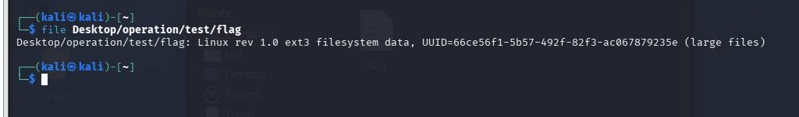
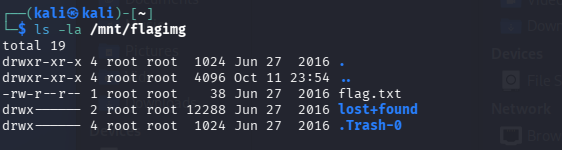

### 题目名称：linux

题目来源：Bugku CTF

题目类别：MISC

题目描述：一个tar.gz压缩包

### 解题思路

无，马后炮。

听从deepseek，.gz 是 Linux/Unix 系统上最常见的压缩格式，再加上题目名称就叫 linux，所以这题在 Linux 系统里解压处理就行。我是在 VMware 的 Kali 里用终端做的。

解压后用 file 指令检查文件的真实类型，发现其为 ext3 文件，将其挂载。

### 详细步骤

1. 解压压缩包

    `tar -xzvf 1.tar.gz`

2. 查看那个 flag 文件的真实类型，发现它不是文本，而是一个 ext3 文件系统镜像

    `file test/flag`

    

3. 新建挂载点

    `sudo mkdir -p /mnt/flagimg`

4. 挂载镜像（ro 表示只读，避免改动镜像）

    `sudo mount -o loop,ro test/flag /mnt/flagimg`

5. 查看镜像里的文件，里面有一个 flag.txt

    `ls -la /mnt/flagimg`

    

6. 读取flag

    `cat /mnt/flagimg/flag.txt`

### Payload

无

### flag

key{feb81d3834e2423c9903f4755464060b}

### 总结&反思

本次我学会了用 file 判断文件的真实类型，以及用 mount挂载镜像。（挂载完要记得卸载）
