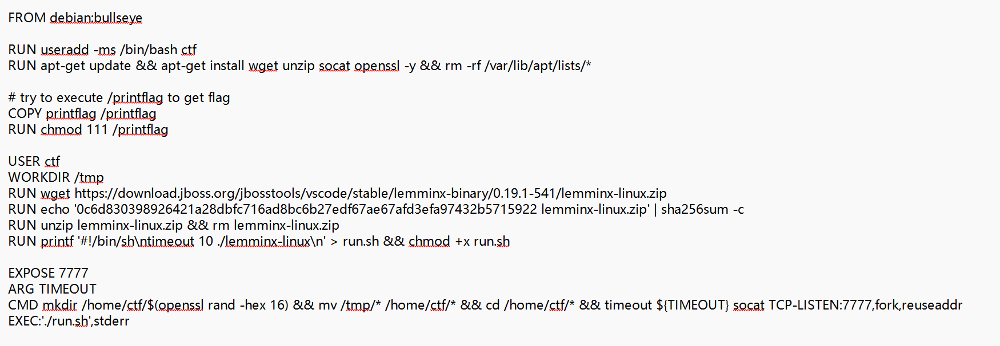

### 题目名称：lemminx

题目来源：CTFHub（原题：2022-HitCon-Misc-lemminx）

题目类别：MISC

题目描述：



附件：[Ch-file-wp03.Dockerfile](Ch-file-wp03.Dockerfile)

### 解题思路

题目给了一份 Dockerfile，环境是一个 XML 语言服务器 lemminx 0.19.1。socat 监听 7777 端口，每来一个连接就执行一次 ./run.sh，而 run.sh 的内容只有一句 timeout 10 ./lemminx-linux。

从 Dockerfile 能读出三个关键事实。第一，/printflag 的权限是 111，只能执行不能读，所以目标不是读文件，而是拿到命令执行。第二，每个连接都会重新执行 run.sh，谁能改动这个文件，谁就能让命令持久化执行。第三，7777 端口上跑的是一个 LSP（语言服务器协议）服务，得按 Content-Length 加 JSON-RPC 的格式跟它对话。

根据dsh，突破口在 initialize 的 initializationOptions 上。查官方 Configuration.md 可知，settings.xml.logs.file 就是日志输出到哪个文件，而这个路径完全由客户端填写，服务器不做任何校验。把日志文件设成 run.sh，日志就会被追加进去；再发一个方法名里带换行的请求，方法名会被原样写进日志，于是 /printflag 就成了 run.sh 里独立的一行。下一个连接执行 run.sh 时，shell 逐行执行，走到那一行就把 flag 打出来了。

### 详细步骤

1. 通读题目给的 Dockerfile，先确认环境的三处特征：/printflag 是 111、run.sh 每个连接都执行、7777 端口跑的是 socat 转发的 LSP 服务

2. 按 LSP 格式写一个客户端。每条消息是 Content-Length 头、一个空行、然后是 JSON-RPC 体，头里的长度必须是正文的字节数

3. 连上去先发 initialize，收到 capabilities 说明链路通了

4. 接着发 initialized 和 textDocument/didOpen，服务器会主动推回 client/registerCapability 和 textDocument/publishDiagnostics，后者提示 No grammar constraints

5. 把"这个程序本来会往磁盘写什么"列一遍。能落到服务器磁盘上的只剩两样：下载缓存和日志。缓存那条路在 0.19.0 已经被堵了，那就只剩日志

6. 查官方 Configuration.md 确认日志配置的写法

    "logs": { "client": true, "file": "path/to/file" }

7. 初始化时把日志文件指向 run.sh。这里用相对路径，因为 lemminx 的工作目录正好就是 run.sh 所在目录

8. 再发一个方法名里带换行的非法请求，服务器会把方法名原样记进日志，/printflag 因此单独成行

9. 断开重连。这次什么都不用发，run.sh 逐行执行，最后一行把 flag 打印出来，获得flag

### Payload

第一步，把日志文件指向 run.sh：

```json
{"jsonrpc":"2.0","id":1,"method":"initialize","params":{"processId":null,"rootUri":null,"capabilities":{},"initializationOptions":{"settings":{"xml":{"logs":{"client":false,"file":"run.sh"}}}}}}
```

第二步，发一个方法名里带换行的非法请求：

```json
{"jsonrpc":"2.0","id":2,"method":"\n/printflag\n","params":{}}
```

之后 run.sh 里会多出这样一段，其中 /printflag 是独立的一行：

    WARNING: Unsupported request method: 
    /printflag

### flag

ctfhub{e51eabe4e33bd887348d1425}

### 总结&反思

动手之前先试过几条路，都没走通，记在这里以免下次重走。

一是把 file:// 当 DTD 读取。这条路确实能确认文件在不在，文件存在会回 There is '1' error in '文件名'，不存在回 Cannot find DTD，但只回错误个数不回内容，属于盲读，读得到却拿不出来。想让它把内容带出来就得靠带外 XXE，把文件内容拼进一个外发请求里，可外部 DTD 里的参数实体在实体值中会被解析器拒掉，外发实体的声明造不出来，这条路就断在这里。

二是缓存路径穿越。lemminx 下载远程 DTD 时会按 URL 路径落到 ~/.lemminx/cache 下，看上去像任意文件写，但 URL 里出现字面 .. 或者编码过的 %2e%2e 都会被拒绝，这个洞对应 CVE-2022-0673，在 0.19.0 就修了，而题目用的是 0.19.1。

三是那几个 executeCommand 命令，xml.associate.grammar.insert 之类的全部返回 -32001，把参数换成对象形态才拿到一句更具体的报错，但也没能走下去。

本题再次大量使用ai，但也让我对LSP协议，及信任边界与客户端可控配置，有了深刻认识。
