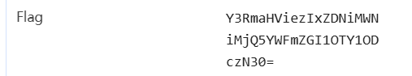

### 题目名称：checkin

题目来源：CTFHub（原题：2017-赛客夏令营-Web-checkin）

题目类别：Web

题目描述：

### 解题思路

这题是签到题，难度不在技术，在思路：别一上来就往注入、文件包含上想。

打开靶场只有 index.php 一个页面，页面上没有任何有用的东西，扫目录也只扫得出来这一个文件。真正的入口根本不在页面上，而在响应包里。

根据dsh，flag 直接放在 HTTP 响应头里，字段名是 Flag，值是一串 base64。判断依据很明确：字符集是大小写字母加数字再加结尾一个 =，长度 44 正好是 4 的倍数，开头 Y3Rm 解出来就是 ctf，所以是标准 base64。解开就是 flag。

这题的重点不是打什么，而是养成看响应头的习惯。

### 详细步骤

### Payload

### flag

ctfhub{21d3b1cb249aafdb59658737}

### 总结&反思
