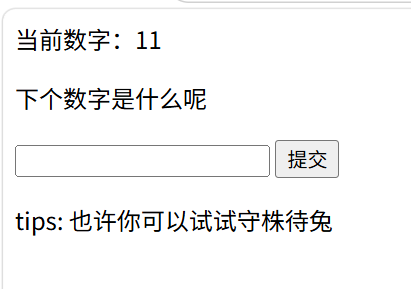
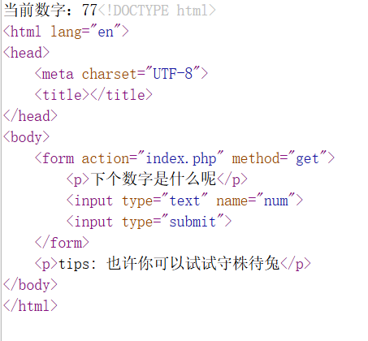

### 题目名称：random

题目来源：CTFHub（原题：2017-赛客夏令营-Web-random）

题目类别：Web

题目描述：





### 解题思路

这题的的代码只是告诉了是如何获取你输入的数字，没有告诉下一个数字会是多少。根据tips，我们可以用一个数字不断注入，等待满足随机数即可。
### 详细步骤

1.http://challenge-19f5b58fdae14894.sandbox.ctfhub.com:10800/index.php?num=4，数字随意。

2.f5手动刷新

3.等待屏幕变化，获得flag。

### Payload

```
GET /index.php?num=4 HTTP/1.1
Host: challenge-19f5b58fdae14894.sandbox.ctfhub.com:10800
```

### flag

ctfhub{edcf8d18f71ffbb0749232a9}

### 总结&反思

这题我用了比较简单的办法手动刷新，但其实可以通过脚本，然后观看日志来自动获取。
