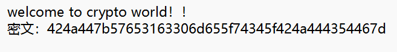

### 题目名称：sign in

题目来源：CTFHub（原题：2020-BJDCTF-Crypto-sign in）

题目类别：Crypto

题目描述：

附件：[Ch-file-wp08.txt](Ch-file-wp08.txt)

### 解题思路

看密文的特征：只有 0-9 和 a-f，没有大写字母、没有 + 和 /、也没有 =，长度 44 是偶数。这是十六进制编码，每两个字符对应一个字节。把每两位按 ASCII 还原，开头 42 4a 44 正好是 BJD，接着 7b 是左花括号，说明后面就是 flag 的内容，一直解到 7d 的右花括号为止。

### 详细步骤

1.识别出base16特征，解码获得flag。

### Payload

无

### flag

BJD{We1c0me_t4_BJDCTF}

### 总结&反思

已经好几次遇到16进制，但是这次好像是我第一次写base16的特征，也算是有长进吧。
