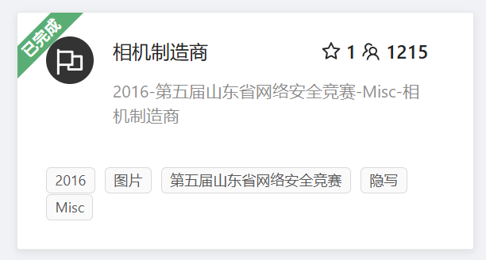

### 题目名称：相机制造商

题目来源：CTFHub（原题：2016-第五届山东省网络安全竞赛-Misc-相机制造商）

题目类别：MISC

题目描述：



附件：[Ch-file-wp11.jpg](Ch-file-wp11.jpg)

### 解题思路

图片隐写先放imhex看看文件头，发现是JPEG，接着往下看即可。

### 详细步骤

1. 下载附件 ex.jpg，用 ImHex 打开

2. 看左上角第一行的前几个字节：FF D8 FF，这是 JPEG 的文件头，说明这是一张普通的 JPEG 照片

3. 在 ImHex 里搜 Flag{，或者直接把右侧的 ASCII 列往下看。在偏移 0x92 附近就能看到明文，获得flag。

    ```
    Flag{6MO3Nbdad7umkHmQ}
    ```

### Payload

无

### flag

Flag{6MO3Nbdad7umkHmQ}

### 总结&反思

以前做过，有了imhex就说试试，没想到一眼就能看见。
