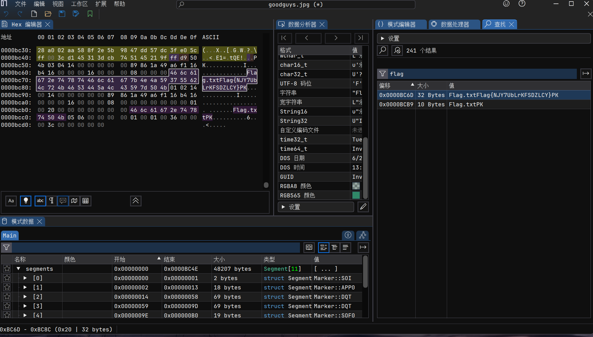
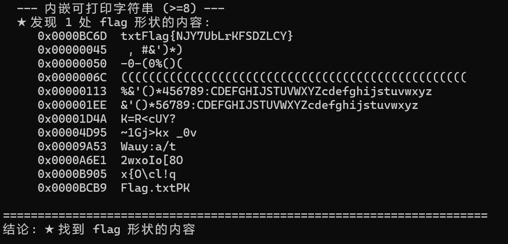

### 题目名称：好孩子看不见

题目来源：CTFHub（原题：2016-第五届山东省网络安全竞赛-Misc-好孩子看不见）

题目类别：MISC

题目描述：


附件：[Ch-file-wp18.jpg](Ch-file-wp18.jpg)

### 解题思路

题目给了一张 JPEG，图片本身看不出异常，所以先怀疑文件里藏了别的东西。图片格式有明确的结束标记，结束标记后面的字节看图软件根本不管，经常被拿来附加压缩包。

先在十六进制里看文件末尾。JPEG 的结束标记是 FF D9，找到它之后紧跟着就是 50 4B 03 04，也就是 PK 头，说明后面接了一个 ZIP。再往后还能看到 Flag.txt 这个文件名和明文的内容。

因为这个文件在压缩包里用的是「仅存储」，没有压缩，所以内容在十六进制里就是明文，不解压也能直接看见。把整个文件当 zip 打开，或者直接用解压软件打开这张图，就能拿到 Flag.txt。

### 详细步骤

1. 打开图片，画面正常，看不出异常

2. 用 ImHex 打开，翻到文件末尾。JPEG 的结束标记 FF D9 在 0x0000BC4D，紧接着 0x0000BC4F 就是 50 4B 03 04，也就是 PK 头

    

3. 在查找窗口里搜 flag，能看到 0x0000BC6D 处有一段明文

    

4. 既然尾部是一个 ZIP，直接用解压软件打开这张 jpg，里面就一个 Flag.txt

    ```
    Flag{NJY7UbLrKFSDZLCY}
    ```

    也可以不改后缀，直接用 7-Zip 或 WinRAR 打开这个 jpg

    附件：[Flag.txt](Ch-file-wp18-2.txt)

5. 得到 Flag{NJY7UbLrKFSDZLCY}，获得flag

### Payload

直接当 zip 解出来

```powershell
& 'D:\work\python\python.exe' -c "import zipfile;z=zipfile.ZipFile('goodguys.jpg');print(z.read('Flag.txt').decode())"
```

反过来，自己做一个同样的图种

```powershell
copy /b 原图.jpg + 包.zip 结果.jpg
```

### flag

Flag{NJY7UbLrKFSDZLCY}

### 总结&反思
