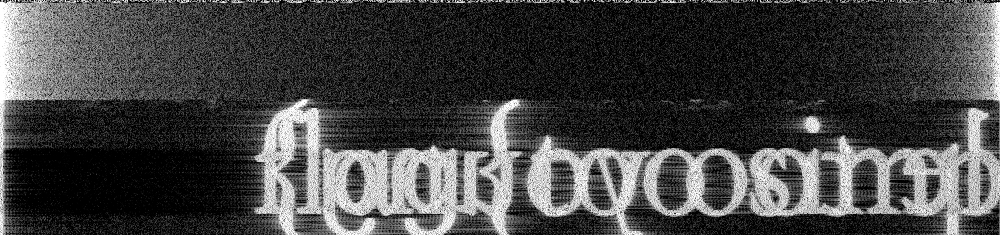

### 题目名称：另一个隐藏的黑客

题目来源：CTFHub（原题：2019-工业信息安全技能大赛-山东站-另一个隐藏的黑客）

题目类别：MISC

题目描述：

根据情报得知在工控现场有黑客在对外传输无线信息，被我们捕获到。你能分析出来flag么?flag形式为 flag{}。

附件：[Ch-file-wp19.666](Ch-file-wp19.666)

### 解题思路

压缩包解开只有一个 soeasy.666，文件头是 10 02 F8 03，不匹配任何常见格式，按文本打开是乱码，说明是裸的二进制数据。题目标签是无线电(SDR)，所以它不是普通音频，而是 SDR 采集下来的 I/Q 原始数据，两个 int16 一组，一个是 I 一路是 Q。

按复数信号去看频谱，图上就画着 flag。要注意两点：一是必须当成复数处理，只取正频率那一半，不然正负频率两份会叠在一起；二是字本身是手写体而且有重叠，得硬看加猜。

### 详细步骤

1. 解开压缩包只有一个 soeasy.666，2346552 字节，除以 4 得 586638，正好是复数样本数，符合 16 位 I/Q 的排列

2. 按两个 int16 一组读成复数，前一组是 I、后一组是 Q

    ```python
    raw = np.fromfile('soeasy.666', dtype=np.uint8)
    V = raw[:len(raw)//4*4].view(np.int16).reshape(-1, 2)
    z = V[:, 0].astype(np.float32) + 1j*V[:, 1].astype(np.float32)
    ```

3. 做短时傅里叶变换，用复数 FFT，然后只保留正频率那一半

    ```python
    win, hop = 4096, 256
    w = np.hanning(win).astype(np.float32)
    fr = np.lib.stride_tricks.sliding_window_view(seg[:win+(m-1)*hop], win)[::hop]
    S = np.abs(np.fft.fftshift(np.fft.fft(fr*w, axis=1), axes=1))
    S = 20*np.log10(S+1e-6)
    pos = S[:, S.shape[1]//2:]
    ```

4. 每一列单独归一化后转成灰度图

    ```python
    lo = np.percentile(pos, 20, axis=1, keepdims=True)
    hi = np.percentile(pos, 99, axis=1, keepdims=True)
    Nz = np.clip((pos-lo)/np.maximum(1e-6, hi-lo), 0, 1)
    Image.fromarray((Nz.T[::-1]*255).astype(np.uint8), "L").save("spec.png")
    ```

5. 图上能看出 flag 字样，字是手写体而且有重叠，一边看一边猜

    

    另一条路是不写脚本，直接把 soeasy.666 用 Audition 当原始数据导入，编码选 16-bit、字节序 Little-endian、声道 2（I/Q 交织），采样率随便填，然后显示频谱，效果一样

    ```
    flag{too simple too young}
    ```

6. 得到 flag{too simple too young}，获得flag

### Payload

无

### flag

flag{too simple too young}

### 总结&反思

这题简直逆天，我好不容易喂出一个频谱，结果是重叠的，我还在琢磨怎么把频谱拆成两份，结果告诉我wp也是硬看。
