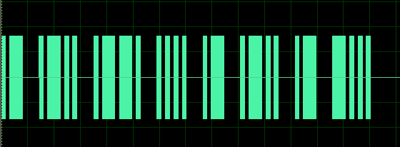

### 题目名称：滴答滴答

题目来源：CTFHub（原题：2016-第五届山东省网络安全竞赛-Crypto-滴答滴答）

题目类别：Crypto

题目描述：



### 解题思路

题目只给了一张图，图上是绿柱和黑缝交替，柱子有粗有细，缝也有宽有窄。题目叫滴答滴答，这种长短不一的柱子就是摩斯电码。

细的柱子是点，粗的柱是杠；柱子之间窄的缝是同一个字母内部，宽的缝是字母之间的分隔。按宽缝把他们切开，一组一组写出点和杠，再查摩斯表就能还原字母。

### 详细步骤

1. 打开图片，绿色柱子粗细不一样，柱子之间的缝也有宽有窄

2. 对照摩斯：细柱是点，粗柱是杠；窄缝是同一个字母内部，宽缝是字母之间的分隔

3. 按宽缝把柱子切开，一组一组写成点和杠，再查表

    ```
    1)  细 粗                →  .-      →  A
    2)  细 粗 细 细          →  .-..    →  L
    3)  细 粗 粗 细          →  .--.    →  P
    4)  细 细 细 细          →  ....    →  H
    5)  细 粗                →  .-      →  A
    6)  细 粗 细 细          →  .-..    →  L
    7)  细 粗                →  .-      →  A
    8)  粗 细 细 细          →  -...    →  B
    ```

    连起来就是 ALPHALAB

4.  得到 flag{ALPHALAB}，获得flag

### Payload

无

### flag

flag{ALPHALAB}

### 总结&反思

根据题目和图像能很轻松看出是摩斯密码
