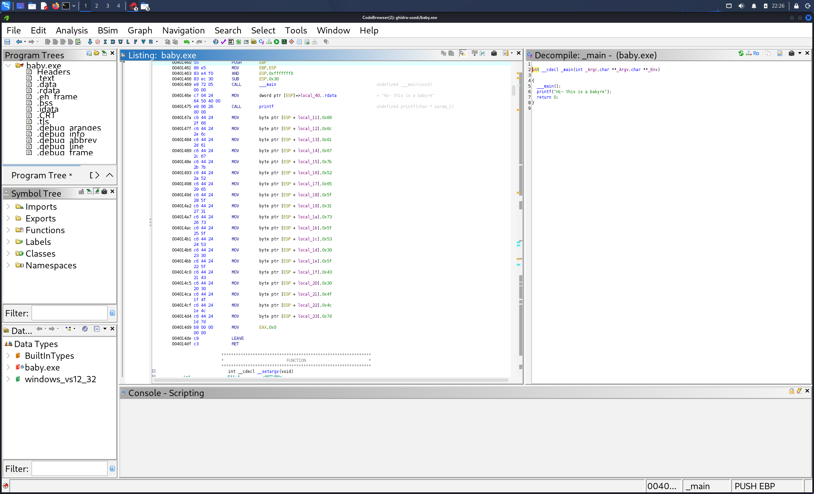

### 题目名称：入门逆向

题目来源：Bugku CTF

题目类别：Reverse

题目描述：一个exe文件

### 解题思路

无，马后炮。

听从deepseek，exe逆向要用反汇编工具打开程序，先在程序里的字符串中找线索，再顺着字符串找到用到它的那段代码。本题搜到 "Hi~ this is a babyre"，跟着它进到 _main 函数，看到函数里把 flag 一个字符一个字符写进栈，每个字符都是十六进制。

我是在 VMware 的 Kali 里用 Ghidra 做的。

### 详细步骤

1. Ghidra 导入 baby.exe

2. 分析文件，进入 _main 函数

3. 右边 Listing 窗口看反汇编，从 0x40147a 到 0x4014d4 是一串 MOV 指令，每行把一个十六进制数写进栈

    

4. 把这一串十六进制按 ASCII 码转成字符

5. 获得flag

### Payload

无

### flag

flag{Re_1s_S0_C0OL}

### 总结&反思

本次是我首次用 Ghidra 做 exe 逆向，经deepseek指导，学会了从字符串入手找函数。

这串赋值在反编译窗口（Decompiler）里看不到，只有反汇编列表（Listing）里才能看到。

和16进制的一些特征。但是对很多操作还不熟悉，需要继续学习。
