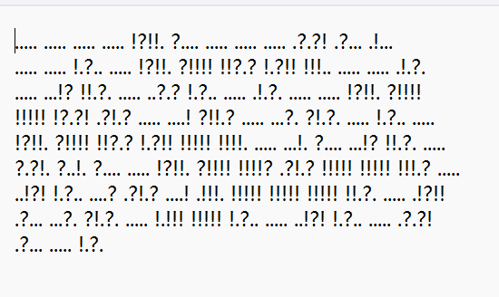

### 题目名称：

题目来源：Bugku CTF

题目类别：Misc

题目描述：

### 解题思路

这串密文只有三种符号（`.` `!` `?`），第一反应是 Brainfuck 的变种——Brainfuck 的变种往往只换符号、不换逻辑。按"三种符号 + 定长分组 + Brainfuck 变种"这个特征去搜，确认是 Ook!：`.` `?` `!` 分别是 `Ook.` `Ook?` `Ook!` 的简写，两个 token 一组就是一条 Brainfuck 指令（5 个一组只是排版，不是编码单位）。

要注意 Ook! 和 Brainfuck 是程序而不是编码，所以最后一步不是查表替换，而是把这 247 条指令跑起来，程序输出才是答案。

我是在 Windows 上用 python 脚本解的。

### 详细步骤

1. 看特征：一共 495 个符号，只有三种，两两一组。

2. 按"Brainfuck 变种"的方向查特征，确认编码是 Ook!，用工具转译。

3. 把符号两两配对，按上表还原成 247 条 Brainfuck 指令。

4. 工具运行

5. 获得flag

### Payload

无

### flag

flag{bugku_jiami}

### 总结&反思

本体考察对brainfuck语言的认识，熟悉其特征可以快速识别。
