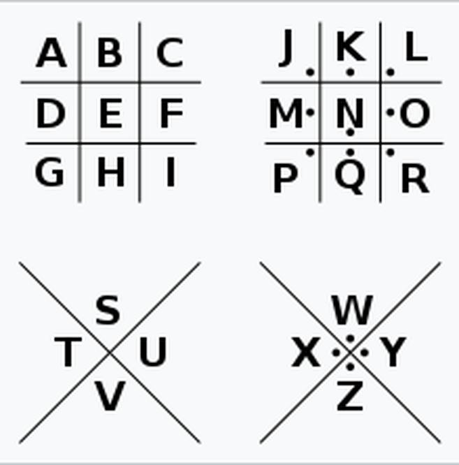

### 题目名称：把猪困在猪圈里

题目来源：Bugku CTF

题目类别：Crypto

题目描述：flag{}

（附件：[file.txt](wp22-file.txt)）

### 解题思路

下载附件得到一个 file.txt，里面只有 base64 字符（大段 A 中间夹着可读字符，这个特征很明显）。

根据dsh，base64 解码后得到的不是文字，而是一个图片文件。打开图片，里面是一行几何符号（由直角、斜角线条组成，有的带小点）。

结合题目名称"把猪困在猪圈里"，想到猪圈密码，对照猪圈密码表逐个还原成字母，就得到明文。

### 详细步骤

1. 下载附件，得到一个 txt，里面只有 base64 字符（大段 A 中间夹着可读字符）

2. base64 解码，得到一个图片文件

3. 认出图里的符号是猪圈密码（格子边框形状 + 点）

4. 对照猪圈密码表逐个还原字母，得到 thisispigpassword

5. 获得flag

### Payload

无

### flag

flag{thisispigpassword}

### 总结&反思
