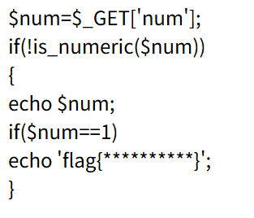

### 题目名称：矛盾

题目来源：Bugku CTF

题目类别：Web

题目描述：

### 解题思路

根据dsh，这段代码的矛盾点是：两个判断用的不是同一套标准。

is_numeric($num) 看的是"字符串的格式像不像数字"；而 $num == 1 看的是"把它转成数字之后是多少"。

所以要找一个"格式上不像数字、转成数字却正好是 1"的串。在 1 后面加一个空格，正好同时满足这两条：

is_numeric("1 ") → false（老版本 PHP 不认"带尾巴"的数字，所以能进入代码往下走）

"1 " == 1 → true（== 会把字符串转成数字，开头是 1 就取 1，所以能打印 flag）

空格在网址里必须写成 %20，所以最终传的参数是 ?num=1%20。

### 详细步骤

1.在网址后输入?num=1%20

2. 页面输出 flag

### Payload

?num=1%20

### flag

flag{e87bf4d1abfb1b06aa8d0d249a7b8137}

### 总结&反思

据dsh所说本次题目考察PHP弱比较，由于==仅比较数值是否相等所以可以通过加空格完成。在得知答案前我曾想是否可以用html会自动编码html实体来解决，但是据dsh说html实体只会被浏览器渲染无法在源码中转换。
