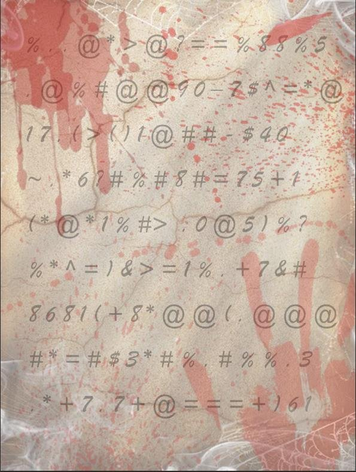

### 题目名称：黄道十二宫

题目来源：Bugku CTF

题目类别：Crypto

题目描述：



### 解题思路

根据dsh，这道题用的是历史上"黄道十二宫杀手"那套密码（Z340）：同音替换 + 置换两层。

所以要先把图片里的符号按 15 列排成矩阵，按"跳马步"重读一遍把顺序还原，再用 AZdecrypt 解同音替换。

### 详细步骤

1. 提取附件文字（建议手动）

2. 密文按"跳马步"重排：从第 0 行第 0 列开始，每读一个就向下 1 行、向右 2 格（列超过 14 就回绕到 0，行只走 0 到 8）；这样得到 15 条独立的斜线，每条 9 个字符，合起来正好 135 个，就是重排后的密文

    ```
    %%>%,,@3*
    ,#(#0+@#+
    ,@)8@7@*7
    @@1#5&8=,
    *9@=)#6#7
    >0#7%%8$+
    @-#5?*13@
    ?7-+(^(*=
    =$$1*=+#=
    =^4~@)8%=
    %+0,*&*,+
    8*181>@#)
    8@76%=@%6
    %,,?#1(%1
    5@(#>%,,,
    ```

3. 用 AZdecrypt 解同音替换，把重排后的密文粘进去，点 Solver

4. 得到明文，取最后两个单词，小写、去空格

5. 获得flag

### Payload

无

### flag

flag{alphananke}

### 总结&反思

这是我本次首次接触密文破译，确实很有难度，不过确实也丰富了我的阅历，让我首次遇到了真实的密文置换。
