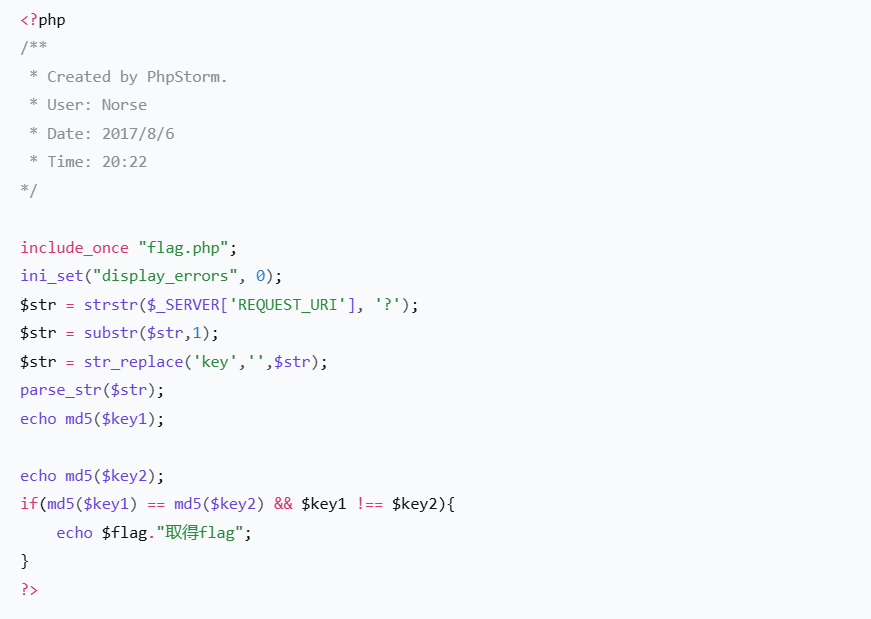

### 题目名称：备份是个好习惯

题目来源：Bugku CTF

题目类别：Web

题目描述：d41d8cd98f00b204e9800998ecf8427ed41d8cd98f00b204e9800998ecf8427e

### 解题思路

无，马后炮。

听从deepseek，题目名"备份是个好习惯"就是提示：网站可能把自己的源码备份留在了目录里。扫目录能扫到一个 index.php.bak，下载下来就能读到源码。

源码里有两个考点。

第一个是先把请求里所有的 key 删掉（str_replace('key','',$str)），本意是不让人传 key1、key2 这两个参数名；但它只从左往右扫一遍，删掉之后不会回头检查新拼出来的字符串，所以参数名写成 kkeyey1，删掉中间那个 key 之后，前面剩下的 k 和后面剩下的 ey1 又拼回了 key1。

第二个是 md5($key1) == md5($key2) && $key1 !== $key2，要求"md5 相等但原文不全等"。用两个 0e 开头的魔法哈希（240610708 和 QNKCDZO）就能满足：它们的 md5 都是 0e 加一串数字，弱比较时会被 PHP 当成数字 0，所以判相等；而两个字符串本身不同，强比较判不全等。

### 详细步骤

1. 访问靶场，页面只有一串 64 位哈希

2. 按题目名"备份"扫目录，发现备份文件 index.php.bak

3. 下载 index.php.bak 读源码，看到 key 过滤和 md5 弱比较两个考点

4. 把参数名写成 kkeyey1、kkeyey2，绕过 key 过滤

5. 传 240610708 和 QNKCDZO 两个 0e 魔法哈希，绕过 md5 弱比较

6. 获得flag

### Payload

http://160.202.254.160:15908/?kkeyey1=240610708&kkeyey2=QNKCDZO

### flag

flag{62e932d65c9795755340734a13c45cd2}

### 总结&反思
