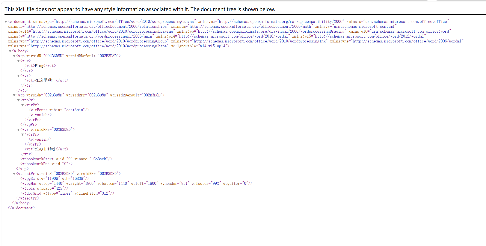

### 题目名称：眼见非实

题目来源：Bugku CTF

题目类别：MISC

题目描述：

附件：[眼见非实.docx](file-wp29.docx)

### 解题思路

本次有些凑巧想用wps打开docx时提示其为zip文件，发觉其本质上是个 zip 包，把它解压开就能看到里面的 xml。正文在 word/document.xml 里，用文本编辑器打开一看，有一段文字被 w:vanish 包着——那是 Word 的「隐藏文字」属性，所以在 Word 里看不见，但在 xml 里一眼就能看见。题名「眼见非实」说的就是这个。（但xml我是默认浏览器打开，不会被隐藏。）

### 详细步骤

1. 把 docx 后缀改成 zip 解压，解压出来是一个同名文件夹，里面才是那一堆 xml

2. 打开 word/document.xml

3. 找到 w:vanish 那一段，后面 w:t 里的文字就是答案

    

4. 得到 flag{Fl@g}

5. 获得flag

### Payload

无

### flag

flag{Fl@g}

### 总结&反思

本次我了解到xml在用word浏览时文本可以被隐藏。
